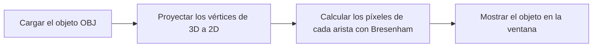
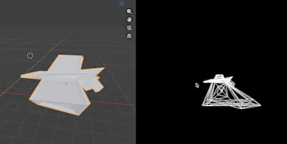

# CC2018 - LAB4

## Rasterizador de archivo .obj

El programa rasteriza el archivo `assets/object.obj` con un modelo ya triangulado. Primero carga sus vértices e indices para las caras. Por cada vertice proyecta los vértices 3D de cada triángulo a coordenadas 2D y dibuja sus tres aristas en el framebuffer con el algoritmo de Bresenham. Finalmente, copia el framebuffer a la ventana.



## Demo



### Cálculos principales

Para un vértice `v = (vx, vy, vz)` y una cámara `c = (cx, cy, cz)`, primero se calcula su profundidad relativa:

```text
z = vz - cz
```

Si `z <= 0.1`, el vértice se descarta porque está detrás de la cámara o demasiado cerca de ella. En caso contrario se aplica la proyección en perspectiva, usando `fov_scale = 90`:

```text
x_pantalla = (vx - cx) / z * fov_scale + ancho / 2
y_pantalla = -(vy - cy) / z * fov_scale + alto / 2
```

La división entre `z` hace que los puntos lejanos se vean más cerca del centro. El signo negativo de `y_pantalla` adapta el eje vertical del mundo 3D al sistema de coordenadas de la pantalla.
